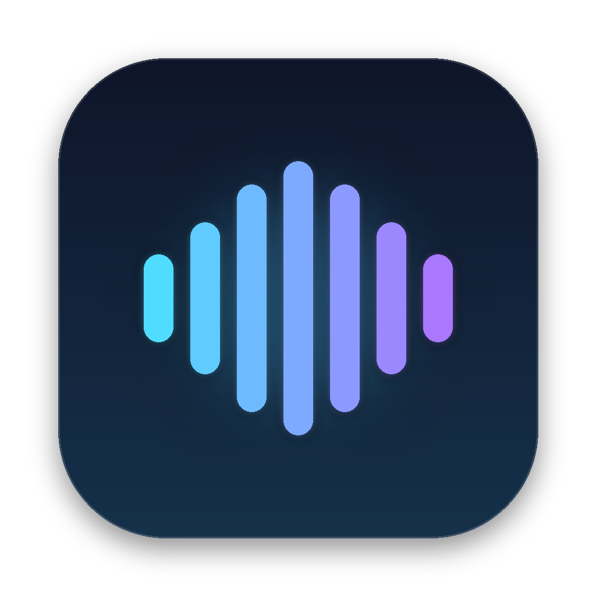

<p align="center">
  
</p>

<h1 align="center">Morpheus</h1>

<p align="center">
  <b>Hands-free voice control for your Mac.</b><br>
  Local speech recognition · a decision model, not a chatbot · asks before it sends anything
</p>

<p align="center">
  
  
  
  <a href="LICENSE"></a>
</p>

---

A hands-free voice assistant that controls your Mac. Say **"Hey Morpheus, ..."** and it opens apps, searches the web, downloads and plays videos, takes screenshots, records the screen, clicks buttons, types, compresses files and sends things on WhatsApp.

```
"Hey Morpheus, open VLC and search the latest Naval podcast on Zen"
"Hey Morpheus, search for an Alex Hormozi short about pricing, download it and play it on VLC"
"Hey Morpheus, take a screenshot and send it to me on WhatsApp"        (asks you to say "yes" first)
"Hey Morpheus, go to example.com and copy the text on the landing page"
"Hey Morpheus, stay with me"   ...then talk without saying "Morpheus" until "that's all"
```

Your voice never leaves your Mac: speech recognition, voice recognition and the spoken replies all run locally. Only the **decision** (which action to take) is made in the cloud, by [Cloudflare's Clef](https://developers.cloudflare.com/workers-ai/), a small *decision* model. It picks from options Morpheus lists; it does not chat or write text. One command costs a fraction of a cent.

> **macOS only.** See [Windows and Linux](#windows-and-linux).

---

## Contents

1. [How it works](#how-it-works)
2. [What you need](#what-you-need)
3. [Install](#install)
4. [Permissions](#permissions)
5. [Using it](#using-it)
6. [Everything it can do](#everything-it-can-do)
7. [Make it yours](#make-it-yours)
8. [Controlling the background app](#controlling-the-background-app)
9. [Privacy and cost](#privacy-and-cost)
10. [Troubleshooting](#troubleshooting)
11. [Windows and Linux](#windows-and-linux)
12. [Project layout](#project-layout)
13. [License](#license)

---

## How it works

```
 microphone
     |
     v
 Silero VAD ............ cuts the audio into sentences                    (local)
     |
     v
 Parakeet TDT 0.6B ..... turns each sentence into text, ~0.2 s            (local)
     |
     v
 wake word + voice check  "Hey Morpheus" starts a command; in conversation
     |                    mode, only YOUR voice counts (TitaNet)          (local)
     v
 split into tasks ...... "open Zen and search X" -> two tasks             (local)
     |
     v
 for each task:
   Morpheus looks at the Mac (open apps, front app, files, workspaces)
   and lists the possible actions                                         (local)
        |
        v
   Clef picks the action, the app, the search words, the file...          (Cloudflare, ~0.5-1.5 s)
        |
        v
   Morpheus does it: AppleScript, the accessibility API, keyboard events,
   screencapture, yt-dlp, ffmpeg...                                       (local)
     |
     v
 a chime + a notification; it speaks (Kokoro) only when you asked it to read or tell you something
```

**Why a decision model and not a chatbot?** A chat model writes free text, so it can invent commands. Clef can only choose among options Morpheus gives it, so every action it can take is one this code wrote. Search words are chosen from pieces of what you actually said, never made up.

---

## What you need

| | |
|---|---|
| **Mac** | macOS 13 or newer. Apple Silicon (M1 or later) recommended; it runs on an 8 GB M1. |
| **Python** | 3.11 or newer |
| **Homebrew tools** | `brew install ffmpeg` (shrinking videos, reading your voice recordings) |
| **Cloudflare account** | Free to create. Workers AI is pay as you go; see [cost](#privacy-and-cost). |
| **Disk** | About 1.1 GB for the local models |
| **Optional** | [AeroSpace](https://github.com/nikitabobko/AeroSpace) for "open X on workspace 2", [VLC](https://www.videolan.org/) for playing media, WhatsApp desktop for sending |

---

## Install

### 1. Get the code and the Python packages

```sh
git clone https://github.com/Al-hussein31/morpheus.git
cd morpheus
python3 -m venv .venv
.venv/bin/pip install -r requirements.txt
```

### 2. Download the local models (about 1.1 GB)

```sh
./scripts/get-models.sh
```

This fetches Parakeet (speech to text), Silero VAD (finds speech), TitaNet (recognises your voice) and Kokoro (its voice) into `models/`.

### 3. Connect Cloudflare

1. In the [Cloudflare dashboard](https://dash.cloudflare.com/), copy your **Account ID** (right side of the home page).
2. Go to **My Profile > API Tokens > Create Token > Custom token**. Give it one permission: **Account > Workers AI > Read**. Nothing else. Create it and copy it.
3. Save the token in your Mac's Keychain (not in a file):

   ```sh
   security add-generic-password -s clef-agent -a cf_api_token -w
   ```

   It asks for the token; paste it.
4. Make your settings file and put your Account ID in it:

   ```sh
   cp config.example.json config.json
   open -e config.json
   ```

### Optional: better web search

Morpheus searches the web in the background when it doesn't understand a command. It works without a key (DuckDuckGo); with a free [Jina](https://jina.ai/) key the results are better. Save the key in the Keychain:

```sh
security add-generic-password -s morpheus -a jina_api_key -w
```

### 4. Try it in the terminal first

```sh
.venv/bin/python agent.py "what apps are open"          # one typed command, no microphone
.venv/bin/python voice.py --wake                         # check it hears "Morpheus" (Ctrl+C to stop)
.venv/bin/python voice.py                                # the full assistant in this terminal
```

`agent.py` needs the token in the environment when run on its own:

```sh
export CF_ACCOUNT_ID=your-account-id CF_API_TOKEN=$(security find-generic-password -s clef-agent -a cf_api_token -w)
```

### 5. Run it in the background, starting at login

```sh
./app/install.sh
```

This builds `~/Applications/Morpheus.app`, adds a login item, starts it, and installs the `morpheus` command. A waveform icon appears in the menu bar. Now give it its permissions (next section).

To remove it completely:

```sh
morpheus stop
rm ~/Library/LaunchAgents/ng.forgegrowth.morpheus.plist
rm -rf ~/Applications/Morpheus.app ~/.local/bin/morpheus
```

---

## Permissions

macOS asks before an app can hear you or control other apps. Morpheus runs as its own app, so the permissions belong to **Morpheus**, not to your terminal.

Open **System Settings > Privacy & Security** and turn Morpheus on in:

| Setting | Needed for |
|---|---|
| **Microphone** | Hearing you (macOS asks on first start; click Allow) |
| **Accessibility** | Clicking, typing, keyboard shortcuts, reading buttons on screen |
| **Screen Recording** (Screen & System Audio Recording) | Screenshots, screen recording, clicking text inside web pages |
| **Automation** | Asked the first time it controls Finder, WhatsApp or System Events; click OK |

Then run `morpheus restart`.

If the microphone is blocked, macOS gives Morpheus silence instead of an error; the menu bar icon turns into a crossed-out microphone and you get a notification.

> **Rebuilding the app resets these permissions.** Only rerun `./app/install.sh` if you changed `app/launcher.c` or `app/install.sh`. After editing Python files, `morpheus restart` is enough.

---

## Using it

### Commands

Start with the wake word, then say what you want in one breath:

> "Hey Morpheus, open Zen and search for flights to Lagos."

Or say just **"Morpheus"**, wait for the *tink*, then say the command.

What you hear back:

| Sound | Meaning |
|---|---|
| *Tink* | Heard its name, waiting for the command |
| *Glass* | Done (details in the notification) |
| *Purr* | Didn't understand. Say it another way within 6 seconds, no need to say "Morpheus" |
| *Submarine* | Waiting for your **"yes"** (sending something, running a command) |
| *Basso* | Something failed, or you cancelled |
| *Hero* / *Bottle* | Conversation mode started / ended |

### Several things at once

"and", "then" and "also" separate tasks when an action word follows, and so do separate sentences:

> "Open VLC on workspace 2 and open Chrome. Then search the Lex Fridman podcast."

Each task can use what the one before it made or found: *"download it and play it on VLC"*, *"take a screenshot and send it to me on WhatsApp"*, *"open the music folder and play those on VLC"*.

### Conversation mode

Say **"Hey Morpheus, stay with me"** (or "keep listening", "let's talk", "I want to keep talking to you"). The menu bar icon becomes two speech bubbles. Now every sentence **in your voice** is a command, with no wake word:

> "open YouTube" ... "search Alex Hormozi pricing" ... "scroll down" ... "that's all"

It ends when you say **"that's all"**, **"thanks Morpheus"**, **"you can sleep"** or **"stop listening"**, or after 3 quiet minutes.

**Your voice only.** Morpheus learns your voice (see [Your voice profile](#your-voice-profile)) and ignores other voices: a video playing, someone on a call, someone in the room. Note that anything *you* say counts, so end the conversation before talking to someone else. Sending and running commands still wait for your "yes".

Also, for **8 seconds after any command**, you can give the next one without saying "Morpheus".

### When it doesn't understand

Instead of giving up, Morpheus tries these in order and stops at the first that fits:

1. **"Did you mean ...?"** It compares what it heard with commands that worked for you before (and common ones). *"open you tube"* becomes *"Did you mean, open YouTube?"* Say **yes** and it runs, and it remembers: next time that phrasing runs straight away.
2. **A file or folder with that name.** *"Should I open the folder Forge Growth?"*
3. **A web search, without opening a browser.** Questions and longer sentences are searched in the background ([Jina](https://jina.ai/) if you add a key, DuckDuckGo otherwise). It reads out the top answer, lists the results under **Last web search** in the menu bar, and keeps every search in `~/Library/Application Support/Morpheus/searches.md`. Say *"open the first one"* to open a result.
4. **"I heard: ... Say it again?"** If it was too garbled for all of that, it tells you what it heard, so you know whether to speak up or add the word to `vocab.txt`.

In conversation mode, sentences it can't use are ignored silently (you are probably talking to someone else).

### When it talks

Morpheus stays quiet and uses sounds and notifications, except when:

- you ask it to **read** or **tell** you something ("tell me about ...", "who is ...", "what is ...")
- it needs a **yes** from you
- it didn't understand (see above)

The voice is set by `speaking_voice` in `config.json`. While it speaks, the microphone is off, so it never hears itself; answer its question right after it finishes.

---

## Everything it can do

| Ask | What happens |
|---|---|
| "what apps are open" | Lists them |
| "open / quit Spotify" | Opens or quits an app (misheard names are matched loosely) |
| "open VLC on workspace 2" / "go to workspace 3" | Moves or switches with AeroSpace |
| "search best laptops 2026 on Zen" | Searches in that browser |
| "search Alex Hormozi pricing on YouTube" | Searches inside YouTube (also GitHub, Reddit, Amazon, Wikipedia, X) |
| "go to example dot com" / "open the Stripe website" | Opens the site (by address, or the top search result for a name) |
| "copy the text on this page" | Copies all text in the front window or web page |
| "play the Naval podcast" | Finds the file on your Mac (Spotlight) and plays it |
| "open the voices folder" / "open my SIWES report" | Finds the folder or file **anywhere** in your home folder (Spotlight) and opens it. If several look alike, it asks first. |
| "play those on VLC" (after opening a folder) | Plays every audio and video file in it as a playlist |
| "search for an X short about Y and download it" | Searches YouTube, picks the best match, downloads an MP4 to `~/Downloads/Morpheus` |
| "download this video" | Downloads the video open in the browser |
| "take a screenshot" / "screenshot this window" | Saves it where macOS saves screenshots |
| "start recording my screen" ... "stop recording" | Saves a movie to `~/Movies/Morpheus` |
| "compress this file" | Zips what is selected in Finder (or the last file it made); a video is shrunk instead |
| "click Downloads" / "click the send button" | Finds the button or text on screen and clicks it |
| "type see you at five" | Types it into the front app |
| "copy" / "paste" / "undo" / "save" / "refresh" / "scroll down" / "new tab" / "go back" | Presses the shortcut |
| "send hey, on my way to Tunde on WhatsApp" | Opens the chat, types it, **waits for your "yes"** |
| "send this document to me on WhatsApp" | Attaches the file, **waits for your "yes"** |
| "open tmux in Ghostty" | Runs it in a new terminal tab (anything not on the safe list waits for "yes") |
| "run disk space" | Runs one of your [saved commands](#saved-commands) |
| "reduce my sound" / "set the volume to low" / "mute" | Changes the volume |
| "make the screen brighter" / "dim the screen" / "brightness to half" | Screen brightness (also the keyboard light) |
| "pause the music" / "next track" | Media keys, for whatever app is playing |
| "turn on dark mode" / "turn off Wi-Fi" / "lock my screen" / "sleep" | Mac settings |
| "restart my Mac" / "shut down" / "log out" / "empty the trash" | **Waits for your "yes"** |
| "tell me about John D. Rockefeller" / "who is Naval Ravikant" / "how did X ..." | Searches in the background, a small text model writes a 2 to 3 sentence answer from the results, and Morpheus **reads it to you**; no browser opens |
| "open the folder where my CAC certificate is" | Finds the file and shows it selected in its folder |
| "... on workspace 6" (after any open) | Moves the new window to that AeroSpace workspace |
| "open the first one" (after a web search) | Opens that result in your browser |
| "stay with me" ... "that's all" | [Conversation mode](#conversation-mode) |

---

## Make it yours

All personal files are ignored by git; each has an `.example` version to copy.

### `config.json`

```json
{
  "cloudflare_account_id": "your Cloudflare account ID",
  "whatsapp_self_chat": "your name as WhatsApp shows your own chat, e.g. @yourname",
  "my_names": ["me", "myself", "my own chat", "yourname"],
  "terminal": "Ghostty",
  "speaking_voice": "bm_fable",
  "answer_model": "@cf/openai/gpt-oss-20b"
}
```

- `whatsapp_self_chat` and `my_names`: "send it to **me**" goes to your own WhatsApp chat.
- `terminal`: the app used for "open tmux in ...".
- `answer_model`: the [Workers AI text model](https://developers.cloudflare.com/workers-ai/models/) that writes spoken answers. It only answers questions, from search results; it never decides what to do (Clef does). If it fails, `llama-3.2-3b-instruct` takes over, then the plain search snippets.
- `speaking_voice`: any [Kokoro voice](https://huggingface.co/hexgrad/Kokoro-82M/blob/main/VOICES.md). Names starting with `b` speak British English, `a` American: `bm_fable`, `bm_george`, `am_michael`, `af_heart`...

### `vocab.txt`: words it mishears

Speech recognition gets names wrong, especially with accents. List the right word and what it hears instead:

```
Alex Hormozi: aleximosi, alex musi
Zen: zem
tmux: tmox
```

Close misspellings of longer words ("Hormozy" for "Hormozi") are fixed without listing them. Check `~/Library/Logs/Morpheus.log` to see what it heard.

### Saved commands

`commands.json` maps a name you say to a shell command:

```json
{
  "disk space": "df -h / | tail -1 | awk '{print $4 \" free of \" $2}'",
  "my ip address": "curl -s https://api.ipify.org"
}
```

Say "run disk space". The output appears in the notification. Morpheus never makes up shell commands; it only runs ones you wrote here, or names a program to open in the terminal.

### Your voice profile

The first time it starts, Morpheus builds a profile of your voice from recordings in [Handy](https://handy.computer)'s folder, if you use it. After that it keeps learning from commands that are clearly you. The profile is `models/voice-profile.npy`; delete it to start over.

No Handy? Until a profile exists, conversation mode cannot tell voices apart and accepts any voice. Give it a few normal "Hey Morpheus" commands and it learns yours.

---

## Controlling the background app

| | |
|---|---|
| **Menu bar icon** | Shows the state (listening, working, conversation, paused, no mic) and the last command. Menu: Pause, Open log, Restart, Quit. |
| **Kill switch** | **Ctrl + Option + Cmd + M**: stops listening and stops everything running (downloads, recording, speech). Press again to resume. |
| `morpheus status` | Is it running? |
| `morpheus pause` | Same as the kill switch |
| `morpheus restart` | Restart (after editing the code) |
| `morpheus stop` / `morpheus start` | Stop until next login / start again |
| `morpheus log` | Watch the log live: what it heard, what Clef chose, what happened |

If it crashes, macOS restarts it within 10 seconds. "Quit Morpheus" in the menu keeps it quit until next login.

---

## Privacy and cost

**Stays on your Mac:** all audio, the transcripts' processing, your voice profile, your files, the spoken replies.

**Sent to Cloudflare** for each step of a command: the text of the command, the names of open apps and the front app, names of matching media files, and the options to choose from. No audio, no screenshots.

**Sent to Jina or DuckDuckGo:** the text of a question you asked, or of a sentence Morpheus didn't understand.

**Sent to the Cloudflare text model:** that question and its search results, to write the spoken answer.

**Remembered on your Mac** in `~/Library/Application Support/Morpheus`: commands that worked (`history.json`, for "Did you mean") and your web searches (`searches.md`). Delete the folder to forget them.

**Cost:** Clef and the answer model run on Workers AI, which has a free daily allowance before it charges. Clef is billed per input token (about $0.24 per million; output is free). A typical command is a few thousand tokens, so a thousand commands cost well under a dollar. Check current prices on [Workers AI pricing](https://developers.cloudflare.com/workers-ai/platform/pricing/).

**Safety:** sending a WhatsApp message or file, and running anything outside the terminal safe list, always waits for your spoken "yes". Anything else cancels.

---

## Troubleshooting

| Problem | Fix |
|---|---|
| Nothing happens when I say "Hey Morpheus" | `morpheus log`: if it shows nothing, check the Microphone permission. If it shows your sentence without "heard:", the name was misheard; run `.venv/bin/python voice.py --wake` to see how it spells you. |
| "New tab needs Accessibility" or clicks do nothing | Turn on Morpheus in Accessibility, then `morpheus restart` |
| Screenshot or recording is empty | Turn on Morpheus in Screen Recording, then `morpheus restart` |
| It picks the wrong thing | `morpheus log` shows Clef's choice and confidence for each step. Rephrase, or add the misheard word to `vocab.txt`. |
| A command takes 10+ seconds | Clef is a network call; Cloudflare is sometimes slow. The log shows the time for each decision. |
| "No token" on start | Run the `security add-generic-password` command from [install step 3](#3-connect-cloudflare) |
| Downloads fail | `.venv/bin/pip install -U yt-dlp` (YouTube changes often) |

---

## Windows and Linux

**Not yet.** The brain (Clef), the ears (Parakeet, Silero, TitaNet) and the voice (Kokoro) run on Windows and Linux. The hands do not: everything that controls the computer uses macOS-only tools (AppleScript, the macOS accessibility API, `screencapture`, `launchd`, the Keychain, AeroSpace).

A port would mean rewriting `actions.py`, `ax.py` and `app/` with Windows equivalents (for example `pywinauto` / UI Automation for clicking, `mss` for screenshots, Task Scheduler for starting at login, Windows Credential Manager for the token). Contributions welcome.

---

## Project layout

```
voice.py              the listener: microphone, wake word, voice check, conversation mode, menu bar
agent.py              the brain: splits commands into tasks, asks Clef, runs the chosen action
actions.py            the hands: keys, typing, clicking, screen, files, downloads, web, WhatsApp
ax.py                 reads and presses on-screen elements through the macOS accessibility API
settings.py           loads config.json (or config.example.json)
memory.py             what it remembers: commands that worked, confirmed phrasings, web searches
app/launcher.c        Morpheus.app's main program: starts voice.py as its child
app/install.sh        builds Morpheus.app and the login item
app/morpheus          the `morpheus` control command
assets/               the app icon (icon.png, Morpheus.icns)
scripts/get-models.sh downloads the local models
*.example.*           templates for your personal config.json, vocab.txt, commands.json
```

### Built with

[Cloudflare Workers AI](https://developers.cloudflare.com/workers-ai/) (Clef) ·
[sherpa-onnx](https://github.com/k2-fsa/sherpa-onnx) (Parakeet, Silero VAD, TitaNet) ·
[Kokoro](https://github.com/thewh1teagle/kokoro-onnx) ·
[yt-dlp](https://github.com/yt-dlp/yt-dlp) ·
[PyObjC](https://pyobjc.readthedocs.io/) ·
[AeroSpace](https://github.com/nikitabobko/AeroSpace)

---

## License

[MIT](LICENSE). Use it, change it, share it.

The models it downloads have their own licenses: Parakeet and TitaNet (NVIDIA, CC-BY-4.0), Silero VAD (MIT), Kokoro (Apache 2.0).
